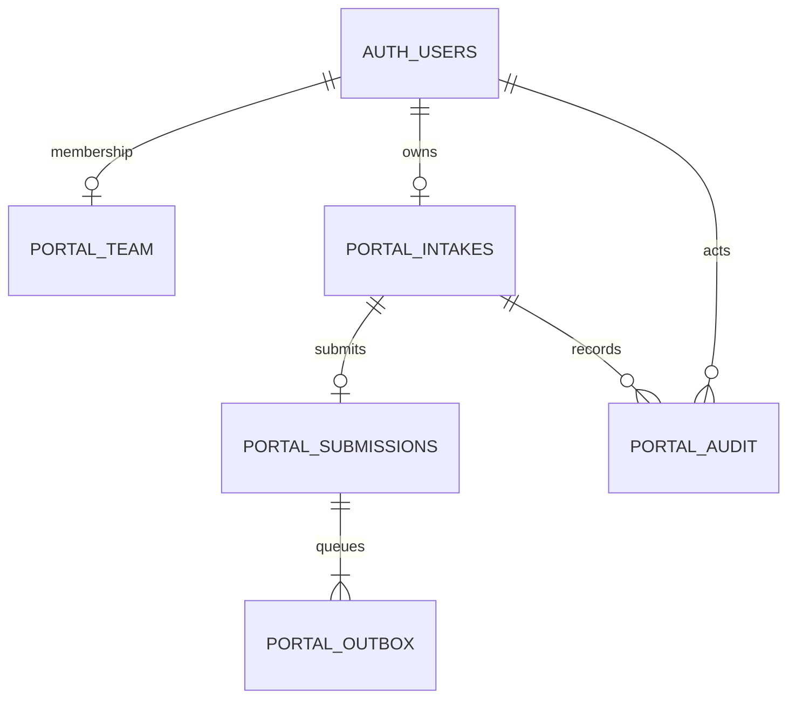

# Modelo PostgreSQL

A migração foi executada num PostgreSQL embutido (PGlite), com utilizadores fictícios e roles `anon`, `authenticated` e `service_role`. O teste verifica RLS, restrições de escrita, revisões, atomicidade e imutabilidade. Isto não substitui a verificação do projeto Supabase alojado.

- Um utilizador tem uma ficha nesta versão. `UNIQUE(owner)` evita duplicação em pedidos simultâneos. Abertura repetida retoma a mesma ficha; novos projetos do mesmo contacto são evolução futura.
- Respostas em JSONB preservam o catálogo flexível; snapshot inclui definição e respostas aplicáveis. A validação Zod ocorre no servidor antes das escritas privilegiadas.
- Leituras usam JWT do utilizador e RLS. `portal_team` não é editável pelos clientes nem deriva de metadata controlável pelo utilizador.
- RPC de escrita só pode ser chamada por `service_role`, guardada exclusivamente no servidor. Cada operação recebe a identidade confirmada por `getUser`, nunca um ator recebido do formulário.
- A submissão bloqueia a ficha, compara revisão e grava snapshot, estado, duas notificações e auditoria na mesma transação. Repetir a chave devolve a mesma submissão.
- PK/UNIQUE indexam proprietário, ficha da submissão e par submissão/destinatário; índices adicionais cobrem ordenação de fichas, fila e FKs da auditoria.
- `pending_configuration` significa sem transporte de email ativo. Não há worker, reenvios nem prova de entrega.
- A migração é aditiva e não foi aplicada remotamente. Não inclui rollback destrutivo: se a ativação falhar, desativar `PORTAL_REMOTE_ENABLED` e preservar os dados para correção aditiva.

## Limite do analisador da skill

Executado `schema_analyzer.py`. O parser não reconheceu nomes qualificados `public.*`; ao remover os qualificadores numa cópia temporária, truncou as tabelas no primeiro parêntese de função/referência e identificou apenas cinco colunas. O resultado bruto `schema-analysis.json` não é uma validação do esquema: contém sugestões de pluralização e um diagrama incompleto. Foram privilegiados o DDL completo, as restrições inspecionadas e o teste PostgreSQL executável. Não foram aplicadas as sugestões `portal_outboxs` ou normalização de snapshots, inadequadas a este modelo.
